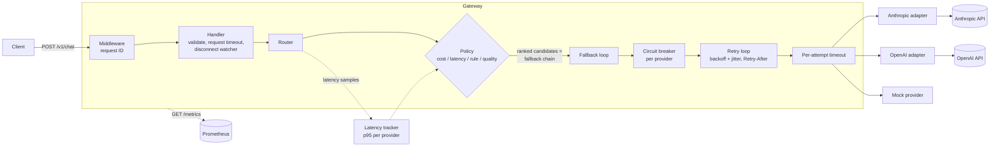
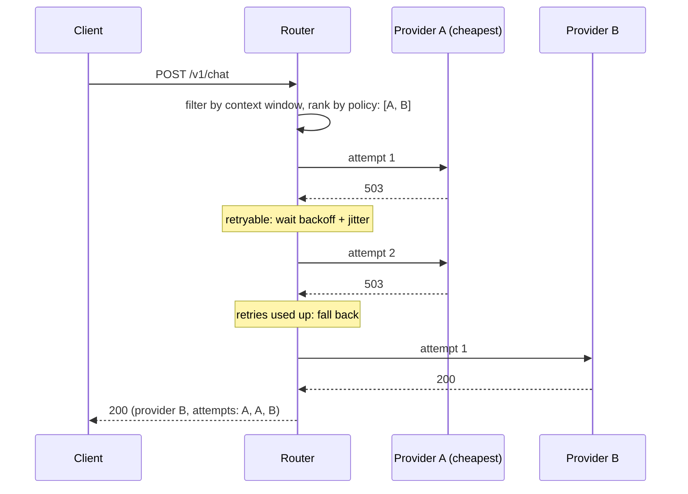
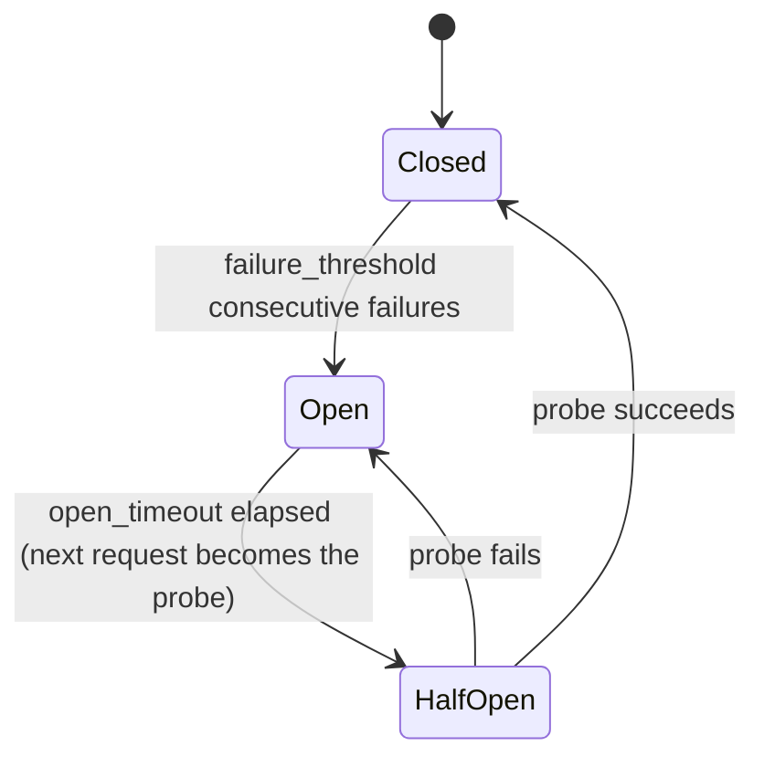

# ModelMux

[](https://github.com/faytonn/modelmux/actions/workflows/ci.yml)
[](LICENSE)

A small LLM gateway in Python. It exposes one endpoint, `POST /v1/chat`, in front of several LLM providers and decides, per request, which provider and model should answer, what to do when it fails, and how to tell you about it.

It is a weekend-sized portfolio project focused on the parts of LLM routing that matter in production: model selection, fallbacks, retries, circuit breaking and cost/latency visibility.

- **Providers:** Anthropic (Claude), OpenAI, and a mock provider with configurable latency, error rate and 429s. **Everything runs and is tested without API keys.**
- **Routing policies:** cost, latency (rolling p95), rule-based, quality. Each request can pick one with `routing_hint`.
- **Reliability:** per-request and per-attempt timeouts (`asyncio.timeout`), retries with exponential backoff and full jitter for retryable errors only, `Retry-After` support, a fallback chain, a per-provider circuit breaker, and cancellation of upstream calls when the client disconnects.
- **Observability:** Prometheus metrics labelled by provider and model, plus structured JSON logs with a request ID on every line.
- **Small dependency set:** FastAPI and uvicorn for HTTP, `httpx` for upstream calls, `prometheus-client`, and PyYAML. No provider SDKs.

## Architecture



A request where the primary provider is down:



### Project layout

```
src/modelmux/
  __main__.py      entry point: config, wiring, uvicorn, graceful shutdown
  config.py        YAML loading, defaults, validation (pydantic)
  providers/       Provider interface, mock, Anthropic, OpenAI, error classification
  router/          policies, latency tracker, fallback loop
  resilience/      generic retry loop and circuit breaker (no HTTP or LLM knowledge)
  server/          FastAPI app, request ID middleware, admin endpoint
  metrics.py       Prometheus collectors
  logs.py          JSON logging, request ID in a ContextVar
  loadtest.py      three-phase load test (healthy / outage / recovery)
tests/             pytest suite, no network or keys needed
deploy/            Prometheus config
```

## Quick start

Requires Python 3.12+ (or Docker only).

```bash
python -m venv .venv
source .venv/bin/activate          # Windows: .venv\Scripts\activate
pip install -e ".[dev]"
python -m modelmux                 # mock providers only, no keys needed
```

```bash
curl -s localhost:8080/v1/chat -d '{
  "messages": [{"role": "user", "content": "Hello!"}],
  "max_tokens": 128,
  "routing_hint": "cheap"
}'
```

```json
{
  "request_id": "9d2cc6dc740d70ed",
  "provider": "mock-cheap",
  "model": "cheap-small",
  "routing_policy": "cost",
  "content": "[mock-cheap/cheap-small] mock reply to: \"Hello!\"",
  "usage": { "input_tokens": 6, "output_tokens": 16 },
  "estimated_cost_usd": 1.4e-05,
  "latency_ms": 92,
  "attempts": [{ "provider": "mock-cheap", "model": "cheap-small", "duration_ms": 91 }]
}
```

`attempts` lists every upstream call, including retries, fallbacks and calls skipped by an open breaker, so you can see exactly what the router did.

**With Docker (gateway + Prometheus):**

```bash
docker compose up --build
# gateway:    http://localhost:8080
# prometheus: http://localhost:9090
```

**With real providers:** put keys in your environment or in a local `.env` (git-ignored, see `.env.example`). A provider whose key is missing is skipped at startup with a warning.

```bash
export ANTHROPIC_API_KEY=...
export OPENAI_API_KEY=...
python -m modelmux --config config.real.yaml
# or: MODELMUX_CONFIG=/etc/modelmux/config.real.yaml docker compose up --build
```

> Model IDs and prices in `config.real.yaml` were checked against each provider's pricing page in October 2026. Prices change, so re-check them before trusting the cost numbers.

### API

`POST /v1/chat`

| Field | Type | Notes |
|---|---|---|
| `messages` | `[{role, content}]` | required; role is `system`, `user` or `assistant` |
| `max_tokens` | int | optional, defaults to `server.default_max_tokens` |
| `routing_hint` | string | optional: `cheap`, `fast` or `quality` |

Unknown fields are rejected, so a typo like `max_token` is a `400` instead of being silently ignored.

Status codes: `200`; `400` invalid request; `422` no model's context window fits the prompt; `502` every provider failed; `504` request budget exhausted; `499` the client disconnected.

Other endpoints: `GET /metrics`, `GET /healthz`, and `PATCH /admin/mocks/{name}` (only with `--admin`, see the load test below).

## Demo walkthrough

A 5-minute demo you can run live, with no API keys. The commands are bash: on Windows, use Git Bash or WSL (PowerShell's `curl` is a different program). `jq` only trims the output to the fields worth looking at.

**1. Start the gateway and Prometheus.**

```bash
docker compose up --build -d     # or, without Docker: python -m modelmux --admin
docker compose logs -f modelmux  # optional, in a second terminal: JSON logs with request IDs
```

**2. One endpoint, different routing policies.** The same prompt goes to a different provider depending on `routing_hint`.

```bash
for hint in cheap fast quality; do
  curl -s localhost:8080/v1/chat \
    -d "{\"messages\":[{\"role\":\"user\",\"content\":\"Hello!\"}],\"routing_hint\":\"$hint\"}" \
    | jq -c '{provider, model, routing_policy, latency_ms}'
done
```

```
{"provider":"mock-cheap","model":"cheap-small","routing_policy":"cost","latency_ms":93}
{"provider":"mock-flaky","model":"fast-medium","routing_policy":"latency","latency_ms":52}
{"provider":"mock-premium","model":"premium-large","routing_policy":"quality","latency_ms":503}
```

`mock-flaky` fails 30% of the time, so the `fast` request sometimes shows a retry in its `attempts`.

**3. Rule-based routing for long prompts.** A prompt of about 3,500 tokens matches the `long-prompts-to-large-context` rule in `config.yaml`.

```bash
jq -n --arg c "$(head -c 14000 /dev/zero | tr '\0' a)" '{messages:[{role:"user",content:$c}]}' \
  | curl -s localhost:8080/v1/chat -d @- | jq -c '{provider, model, routing_policy}'
```

```
{"provider":"mock-premium","model":"premium-large","routing_policy":"rule"}
```

**4. Request tracing.** Send your own request ID. It comes back in the header and the body, and appears on every log line for this request.

```bash
curl -si localhost:8080/v1/chat -H 'X-Request-ID: demo-123' \
  -d '{"messages":[{"role":"user","content":"hi"}]}' | grep -iE 'x-request-id|"request_id"'
```

**5. Validation errors.**

```bash
curl -s -w ' HTTP %{http_code}\n' localhost:8080/v1/chat -d '{"messages":[]}'
curl -s -w ' HTTP %{http_code}\n' localhost:8080/v1/chat \
  -d '{"messages":[{"role":"user","content":"hi"}],"max_tokens":500000}'
```

```
{"request_id":"74d82f6bcddd00a7","error":"messages: List should have at least 1 item after validation, not 0"} HTTP 400
{"request_id":"3f7f354a9763a46f","error":"no model can serve this request"} HTTP 422
```

No model has a 500K-token context window, so the second request gets a `422`.

**6. Outage: retries, fallback and the circuit breaker.** Make the cheap provider fail every call, then send a request.

```bash
curl -s -X PATCH localhost:8080/admin/mocks/mock-cheap -d '{"error_rate": 1}'

chat() {
  curl -s localhost:8080/v1/chat \
    -d '{"messages":[{"role":"user","content":"Hello!"}],"routing_hint":"cheap"}' \
    | jq -c '{provider, attempts: [.attempts[] | {provider, error}]}'
}
chat
```

```
{"provider":"mock-flaky","attempts":[
  {"provider":"mock-cheap","error":"mock-cheap: status 503: mock upstream failure"},
  {"provider":"mock-cheap","error":"mock-cheap: status 503: mock upstream failure"},
  {"provider":"mock-cheap","error":"mock-cheap: status 503: mock upstream failure"},
  {"provider":"mock-flaky","error":null}]}
```

`mock-cheap` was tried 3 times with backoff, then the request fell back to the next provider. The client still got a `200`. Your output can differ: `mock-flaky` fails at random, so the request may also fall through to `mock-premium`. After 5 consecutive failures the breaker opens, and `mock-cheap` is skipped without a network call:

```bash
chat; chat; chat
```

The last lines look like this:

```
{"provider":"mock-flaky","attempts":[{"provider":"mock-cheap","error":"mock-cheap: circuit breaker open"},{"provider":"mock-flaky","error":null}]}
```

If `mock-flaky` has also failed 5 times in a row, its breaker is open too and traffic goes to `mock-premium`. That is the same behaviour on a second provider.

**7. Metrics.**

```bash
curl -s localhost:8080/metrics | grep -E '^modelmux_(circuit_breaker_state|fallbacks_total)'
```

```
modelmux_fallbacks_total{model="cheap-small",provider="mock-cheap"} 4.0
modelmux_fallbacks_total{model="fast-medium",provider="mock-flaky"} 1.0
modelmux_circuit_breaker_state{provider="mock-cheap"} 1.0
modelmux_circuit_breaker_state{provider="mock-flaky"} 0.0
modelmux_circuit_breaker_state{provider="mock-premium"} 0.0
```

Counters add up from when the gateway started, so after earlier runs your numbers will be higher.

The same metrics are in Prometheus at http://localhost:9090. Try the queries from [Observability](#observability), for example `modelmux_circuit_breaker_state`.

**8. Recovery.** Fix the provider. About 10 seconds later (`open_timeout`), the next request is a probe. It succeeds and the breaker closes.

```bash
curl -s -X PATCH localhost:8080/admin/mocks/mock-cheap -d '{"error_rate": 0}'
sleep 11; chat
```

```
{"provider":"mock-cheap","attempts":[{"provider":"mock-cheap","error":null}]}
```

**9. Under load.** The load test runs the same outage and recovery with 16 concurrent clients and prints throughput, error rate, p95 and breaker state every second. See [Load test](#load-test-fallback-and-circuit-breaking-under-failure) for real output.

```bash
python -m modelmux.loadtest --phase 10s
```

**10. Tests.**

```bash
pytest
```

Stop everything with `docker compose down`.

## How routing decisions work

For each request the router:

1. **Estimates prompt tokens** (about 4 characters per token plus per-message overhead).
2. **Filters by context window.** It drops every model where `prompt_tokens + max_tokens > context_window`. If nothing is left, the response is `422`.
3. **Picks a policy.** `routing_hint` overrides the configured default: `cheap` selects cost, `fast` selects latency, `quality` selects quality.
4. **Ranks** the remaining `(provider, model)` candidates with that policy.
5. **Walks the ranking in order.** The ranking *is* the fallback chain. Each candidate gets its own retries. If it still fails, the router moves on to the next one.

| Policy | Orders candidates by | Notes |
|---|---|---|
| `cost` | estimated cost: `prompt_tokens × input_price + max_tokens × output_price` | upper bound, assumes the full `max_tokens` is generated |
| `latency` | rolling **p95** of the last N successful calls per provider; ties broken by cost | unmeasured providers sort first, so every provider gets measured instead of being starved by an early winner |
| `rule` | the first matching rule's `prefer` list first, then everything else in cost order | e.g. prompts ≥ 3000 tokens go to the large-context model |
| `quality` | the `quality` rank from config, descending; ties broken by cost | |

Rules live in config:

```yaml
routing:
  policy: rule
  rules:
    - name: long-prompts-to-large-context
      min_prompt_tokens: 3000
      prefer: [mock-premium/premium-large]
```

Policies are pure functions over the candidate list. They never call a provider, so each one is a few lines of code and is covered by parametrized tests.

## Reliability

**Two time budgets.** `server.request_timeout` bounds the whole request, retries and fallbacks included. A provider's `attempt_timeout` bounds a single call. The router wraps the whole fallback walk in `asyncio.timeout_at(deadline)` and each attempt in `asyncio.timeout(attempt_timeout)`, nested inside it, so an attempt can never outlive the request. The retry loop reads the same deadline, so it never starts a wait that would not fit.

**Client disconnects cancel the work.** The handler runs the router in its own task, next to a second task that waits for the ASGI `http.disconnect` message. If the client goes away first, the router task is cancelled, and the cancellation reaches every in-flight upstream call. The request is logged and counted as `499`, not as a provider failure.

**Retries only for retryable errors.**

| Retried | Not retried |
|---|---|
| 408, 429, 500, 502, 503, 504, 529 (Anthropic "overloaded"), attempt timeouts, network errors | 400, 401, 403, 404, client cancellation, open breaker |

The backoff is *full jitter*: a random wait in `[0, min(max_delay, base_delay × 2^(n-1)))`. This spreads retries so that clients which failed together don't retry together.

**Retry-After.** A `Retry-After` header (seconds or HTTP date) or `retry-after-ms` is treated as a *minimum* wait. If the server asks for longer than `retry.max_retry_after`, or the wait would not fit in the remaining request budget, the router **does not wait**. It gives up on that provider immediately and spends the time on the next candidate instead.

**Fallback.** Any provider error moves on to the next candidate, because a 401 or a model-specific 400 at one provider says nothing about another. Only a cancelled or expired request stops the chain.

**Circuit breaker, one per provider.**



- Only *health* failures count: 5xx, 429, timeouts and network errors. A 400 or 401 means the provider answered, so it counts as healthy. A cancelled request gives no verdict and just frees the probe slot.
- Half-open lets exactly one probe through at a time. On one event loop that holds by construction (the breaker never awaits), and the breaker also takes a lock, so it is safe from threads too. A test checks this with 100 threads released at the same moment.
- The breaker is checked on *every attempt*, so a breaker that opens mid-retry also stops the remaining retries.

## Observability

All metrics are labelled with values from config (`provider`, `model`) or small fixed sets (`outcome`, `code`). Client input never becomes a label, so cardinality stays bounded.

| Metric | Type | Labels |
|---|---|---|
| `modelmux_upstream_requests_total` | counter | provider, model, outcome (`success`, `error`, `rate_limited`, `timeout`, `breaker_open`, `canceled`) |
| `modelmux_upstream_request_duration_seconds` | histogram | provider, model |
| `modelmux_retries_total` | counter | provider, model |
| `modelmux_fallbacks_total` | counter | provider, model (the one that was given up on) |
| `modelmux_tokens_total` | counter | provider, model, direction |
| `modelmux_estimated_cost_usd_total` | counter | provider, model |
| `modelmux_circuit_breaker_state` | gauge | provider (0 closed, 1 open, 2 half-open) |
| `modelmux_http_requests_total`, `modelmux_http_request_duration_seconds` | counter, histogram | code |

Useful queries:

```promql
# upstream error rate per provider (excluding calls the breaker skipped)
sum by (provider) (rate(modelmux_upstream_requests_total{outcome!~"success|breaker_open"}[5m]))
  / sum by (provider) (rate(modelmux_upstream_requests_total{outcome!="breaker_open"}[5m]))

# p95 upstream latency per model
histogram_quantile(0.95, sum by (le, provider, model) (rate(modelmux_upstream_request_duration_seconds_bucket[5m])))

# estimated spend per hour by model
sum by (provider, model) (increase(modelmux_estimated_cost_usd_total[1h]))

# how often each provider pushes traffic elsewhere
sum by (provider) (rate(modelmux_fallbacks_total[5m]))
```

Example `/metrics` output after the load test below (excerpt):

```
modelmux_upstream_requests_total{model="cheap-small",outcome="success",provider="mock-cheap"} 2092.0
modelmux_upstream_requests_total{model="cheap-small",outcome="error",provider="mock-cheap"} 18.0
modelmux_upstream_requests_total{model="cheap-small",outcome="breaker_open",provider="mock-cheap"} 669.0
modelmux_upstream_requests_total{model="fast-medium",outcome="rate_limited",provider="mock-flaky"} 12.0
modelmux_upstream_requests_total{model="fast-medium",outcome="breaker_open",provider="mock-flaky"} 636.0
modelmux_upstream_requests_total{model="premium-large",outcome="success",provider="mock-premium"} 621.0
modelmux_fallbacks_total{model="cheap-small",provider="mock-cheap"} 669.0
modelmux_fallbacks_total{model="fast-medium",provider="mock-flaky"} 637.0
modelmux_circuit_breaker_state{provider="mock-cheap"} 0.0
modelmux_circuit_breaker_state{provider="mock-flaky"} 1.0
modelmux_circuit_breaker_state{provider="mock-premium"} 0.0
```

Logs are JSON, one line per event. The request ID lives in a `ContextVar`, which asyncio copies into every task a request starts, so every line logged during a request carries its `request_id`. The ID is the caller's `X-Request-ID` if it is well-formed (≤ 64 safe characters), otherwise a new random one, and it is echoed back in the response header and body:

```json
{"time":"2026-10-29T03:11:12.200+00:00","level":"INFO","msg":"chat request served","provider":"mock-cheap","model":"cheap-small","policy":"rule","attempts":1,"cost_usd":1.3e-05,"request_id":"demo-123"}
{"time":"2026-10-29T03:10:31.484+00:00","level":"WARNING","msg":"circuit breaker state change","provider":"mock-cheap","from":"closed","to":"open","request_id":"910db043e9db5a42"}
```

## Load test: fallback and circuit breaking under failure

`python -m modelmux.loadtest` drives 16 concurrent clients through three phases. Between phases it uses the admin endpoint to switch the primary provider (`mock-cheap`) between healthy and a 100% error rate:

```bash
python -m modelmux --admin        # or: docker compose up
python -m modelmux.loadtest --phase 12s
```

Real output (trimmed):

```
--- phase healthy: mock-cheap error_rate=0%
[healthy ] t= 10s rps= 143 err=  0.0% p95= 128ms fallbacks=   0 breaker(mock-cheap)=closed    served: mock-cheap=143
--- phase outage: mock-cheap error_rate=100%
[outage  ] t= 13s rps=  29 err=  0.0% p95= 453ms fallbacks=  29 breaker(mock-cheap)=open      served: mock-flaky=29
[outage  ] t= 14s rps=  31 err=  0.0% p95= 1.15s fallbacks=  31 breaker(mock-cheap)=open      served: mock-premium=31
[outage  ] t= 20s rps=  30 err=  0.0% p95= 615ms fallbacks=  30 breaker(mock-cheap)=open      served: mock-premium=30
--- phase recovery: mock-cheap error_rate=0%
[recovery] t= 26s rps=  30 err=  0.0% p95= 592ms fallbacks=  30 breaker(mock-cheap)=open      served: mock-premium=30
[recovery] t= 33s rps=  31 err=  0.0% p95= 609ms fallbacks=  30 breaker(mock-cheap)=closed    served: mock-cheap=1 mock-premium=30
[recovery] t= 34s rps= 121 err=  0.0% p95= 529ms fallbacks=  13 breaker(mock-cheap)=closed    served: mock-cheap=108 mock-premium=13
[recovery] t= 35s rps= 144 err=  0.0% p95= 130ms fallbacks=   0 breaker(mock-cheap)=closed    served: mock-cheap=144
```

What it shows:

- **Clients saw 0% errors through the whole outage.** Every request was served by a fallback.
- **The breaker opened within the first second of the outage.** After that, `mock-cheap` was skipped with no network call (`breaker_open` in the metrics), instead of every request paying for 3 failing attempts plus backoff.
- **`mock-flaky` (30% errors + 10% 429s) tripped its own breaker under load.** Traffic then settled on `mock-premium`. Throughput dropped because the slowest model (~500 ms) was the only healthy one left, but nothing failed.
- **Recovery is automatic.** Once `open_timeout` (10s) passed after the last failed probe, one probe succeeded, the breaker closed, and traffic returned to the cheap model within a second.

## Design trade-offs

| Decision | Why | Cost |
|---|---|---|
| A policy *ranks* candidates and the ranking is the fallback chain | one concept instead of two configs that drift apart; policies are pure and testable | the order is fixed per request; no mid-request re-ranking |
| asyncio on a single event loop | the gateway mostly waits on the network, and thousands of waiting tasks are cheap | CPU-heavy work on the loop stalls every request; scaling past one core means several worker processes, and then each one has its own breakers and latency stats |
| Estimated tokens (chars/4), no tokenizer | no dependency, provider-agnostic, good enough for routing and context-window checks | cost estimates are approximate; billing should use the provider's reported usage (which the metrics do) |
| Latency policy explores unmeasured providers first | avoids starving a provider that has never been tried | a few early requests go to a slow provider |
| Retries never sleep past the deadline or a long `Retry-After` | the remaining budget is better spent on another provider | a provider that would have recovered in 10 s is skipped for this request |
| Fall back on *any* provider error, not just retryable ones | a 401 or model-specific 400 at A says nothing about B | a genuinely bad request is sent to every provider (input is validated first to limit this) |
| Consecutive-failure breaker | simple to reason about and test | at a high sustained error rate (see `mock-flaky` above) it trips readily; production would use a failure *rate* over a sliding window with a minimum request volume |
| One breaker per provider, not per model | outages are usually provider-wide (auth, network, region) | one broken model takes its siblings out for `open_timeout` |
| Plain `httpx` adapters instead of SDKs | minimal dependencies, full control of error classification and `Retry-After` | no streaming or tool use; those would need more API surface |
| Dedicated Prometheus registry | explicit, no global state, tests can create many gateways | slightly more wiring in `__main__` |
| Unauthenticated admin endpoint behind an `--admin` flag | simplest way to inject failures for demos and load tests | must never be enabled in production |

## Testing

```bash
pytest                    # unit + integration tests, no network or keys needed
ruff check .              # lint
ruff format --check .     # formatting
```

CI runs all three on Python 3.12 and 3.14, plus a Docker build.

- **Unit tests:** every routing policy (parametrized), latency tracker, retry/backoff (deterministic jitter, Retry-After, deadline handling, cancellation), circuit breaker (fake clock, all transitions, 100 concurrent threads on the probe), provider adapters against `httpx.MockTransport`, config validation.
- **Router tests:** fallback after retries, attempt timeouts, long `Retry-After`, request budget, client cancellation, open breaker skipping a provider, and the metrics each of these records.
- **Integration tests** (`tests/test_server.py`): the full ASGI app through `httpx.ASGITransport`. Mock A fails, the request falls back to B and succeeds, and the test asserts the attempt trail, request ID and `/metrics` counters. They also cover all-providers-fail, a runtime outage and recovery through the admin endpoint, and request validation.

## What I'd add next

- Streaming responses (SSE), with fallback only allowed before the first token
- A rate-based circuit breaker and per-provider concurrency limits (bulkheads)
- Hedged requests for latency-critical traffic (send to a second provider after p95)
- Token-bucket rate limiting per client, plus per-tenant budgets driven by the cost metrics
- Shared breaker and latency state (e.g. Redis) so several worker processes act as one gateway
- A real tokenizer per provider for accurate context-window checks
- Config hot reload and authentication
