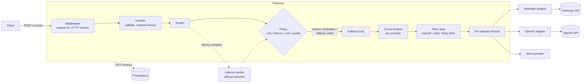
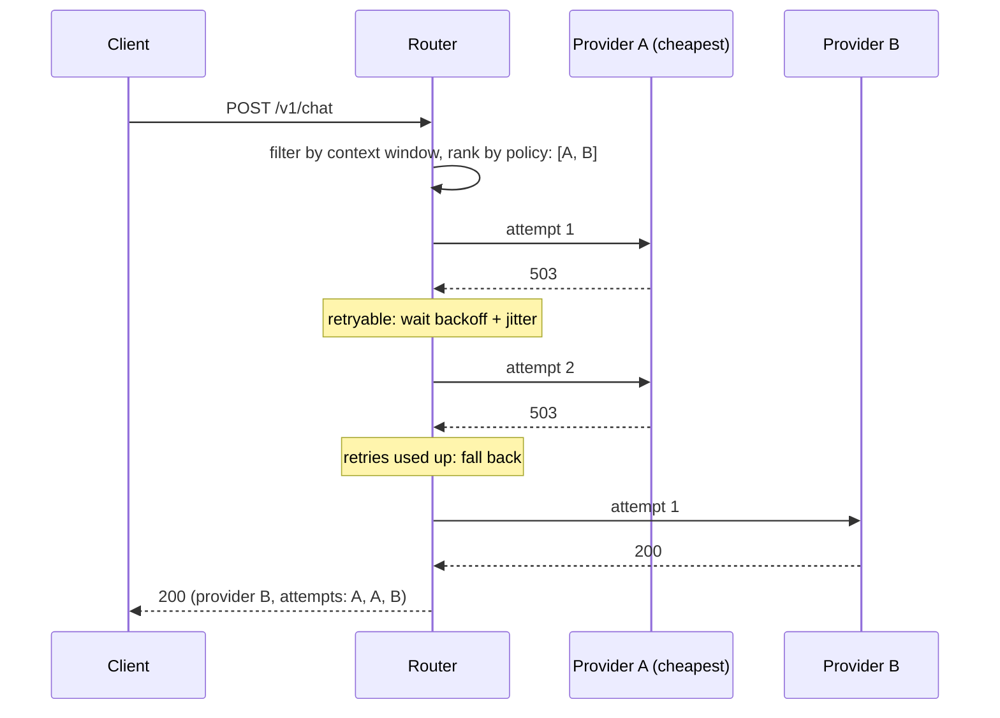
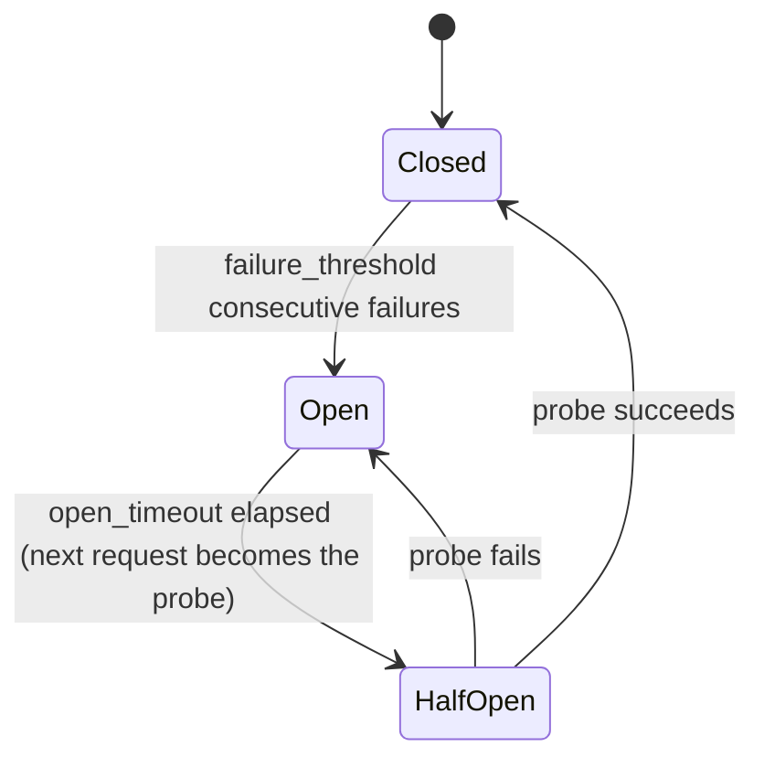

# ModelMux

[](https://github.com/faytonn/modelmux/actions/workflows/ci.yml)
[](LICENSE)

A small LLM gateway in Go. It exposes one endpoint, `POST /v1/chat`, in front of several LLM providers and decides, per request, which provider and model should answer, what to do when it fails, and how to tell you about it.

It is a weekend-sized portfolio project focused on the parts of LLM routing that matter in production: model selection, fallbacks, retries, circuit breaking and cost/latency visibility.

- **Providers:** Anthropic (Claude), OpenAI, and a mock provider with configurable latency, error rate and 429s. **Everything runs and is tested without API keys.**
- **Routing policies:** cost, latency (rolling p95), rule-based, quality. Each request can pick one with `routing_hint`.
- **Reliability:** per-request and per-attempt timeouts (`context.Context`), retries with exponential backoff and full jitter for retryable errors only, `Retry-After` support, a fallback chain, and a per-provider circuit breaker.
- **Observability:** Prometheus metrics labelled by provider and model, plus structured JSON logs (`log/slog`) with a request ID on every line.
- **Small dependency set:** standard library `net/http`, plus `prometheus/client_golang` and a YAML parser.

## Architecture



A request where the primary provider is down:



### Project layout

```
cmd/modelmux/         main: config, wiring, graceful shutdown
cmd/loadtest/         three-phase load test (healthy / outage / recovery)
internal/config/      YAML loading, defaults, validation
internal/providers/   Provider interface, mock, Anthropic, OpenAI, error classification
internal/router/      policies, latency tracker, fallback loop
internal/resilience/  generic retry loop and circuit breaker (no HTTP or LLM knowledge)
internal/metrics/     Prometheus collectors
internal/logging/     request ID in context + slog handler
internal/server/      HTTP handler, middleware, admin endpoint
deploy/               Prometheus config
```

## Quick start

Requires Go 1.26+ (or Docker only).

```bash
go run ./cmd/modelmux                 # mock providers only, no keys needed
```

```bash
curl -s localhost:8080/v1/chat -d '{
  "messages": [{"role": "user", "content": "Hello!"}],
  "max_tokens": 128,
  "routing_hint": "cheap"
}'
```

```json
{
  "request_id": "3f602cab5bfc1cb9",
  "provider": "mock-cheap",
  "model": "cheap-small",
  "routing_policy": "cost",
  "content": "[mock-cheap/cheap-small] mock reply to: \"Hello!\"",
  "usage": { "input_tokens": 6, "output_tokens": 19 },
  "estimated_cost_usd": 0.0000164,
  "latency_ms": 97,
  "attempts": [{ "provider": "mock-cheap", "model": "cheap-small", "duration_ms": 96 }]
}
```

`attempts` lists every upstream call, including retries, fallbacks and calls skipped by an open breaker, so you can see exactly what the router did.

**With Docker (gateway + Prometheus):**

```bash
docker compose up --build
# gateway:    http://localhost:8080
# prometheus: http://localhost:9090
```

**With real providers:** put keys in your environment or in a local `.env` (git-ignored, see `.env.example`). A provider whose key is missing is skipped at startup with a warning.

```bash
export ANTHROPIC_API_KEY=...
export OPENAI_API_KEY=...
go run ./cmd/modelmux -config config.real.yaml
# or: MODELMUX_CONFIG=/etc/modelmux/config.real.yaml docker compose up --build
```

> Model IDs and prices in `config.real.yaml` were checked against each provider's pricing page in October 2026. Prices change, so re-check them before trusting the cost numbers.

### API

`POST /v1/chat`

| Field | Type | Notes |
|---|---|---|
| `messages` | `[{role, content}]` | required; role is `system`, `user` or `assistant` |
| `max_tokens` | int | optional, defaults to `server.default_max_tokens` |
| `routing_hint` | string | optional: `cheap`, `fast` or `quality` |

Status codes: `200`; `400` invalid request; `422` no model's context window fits the prompt; `502` every provider failed; `504` request budget exhausted; `499` the client disconnected.

Other endpoints: `GET /metrics`, `GET /healthz`, and `PATCH /admin/mocks/{name}` (only with `-admin`, see the load test below).

## How routing decisions work

For each request the router:

1. **Estimates prompt tokens** (about 4 characters per token plus per-message overhead).
2. **Filters by context window.** It drops every model where `prompt_tokens + max_tokens > context_window`. If nothing is left, the response is `422`.
3. **Picks a policy.** `routing_hint` overrides the configured default: `cheap` selects cost, `fast` selects latency, `quality` selects quality.
4. **Ranks** the remaining `(provider, model)` candidates with that policy.
5. **Walks the ranking in order.** The ranking *is* the fallback chain. Each candidate gets its own retries. If it still fails, the router moves on to the next one.

| Policy | Orders candidates by | Notes |
|---|---|---|
| `cost` | estimated cost: `prompt_tokens × input_price + max_tokens × output_price` | upper bound, assumes the full `max_tokens` is generated |
| `latency` | rolling **p95** of the last N successful calls per provider; ties broken by cost | unmeasured providers sort first, so every provider gets measured instead of being starved by an early winner |
| `rule` | the first matching rule's `prefer` list first, then everything else in cost order | e.g. prompts ≥ 3000 tokens go to the large-context model |
| `quality` | the `quality` rank from config, descending; ties broken by cost | |

Rules live in config:

```yaml
routing:
  policy: rule
  rules:
    - name: long-prompts-to-large-context
      min_prompt_tokens: 3000
      prefer: [mock-premium/premium-large]
```

Policies are pure functions over the candidate list. They never call a provider, so each one is a few lines of code and is covered by table-driven tests.

## Reliability

**Two time budgets.** `server.request_timeout` bounds the whole request, retries and fallbacks included. A provider's `attempt_timeout` bounds a single call. Both are `context.Context` deadlines. The attempt context is a child of the request context, so an attempt can never outlive the request. A client disconnect cancels everything downstream.

**Retries only for retryable errors.**

| Retried | Not retried |
|---|---|
| 408, 429, 500, 502, 503, 504, 529 (Anthropic "overloaded"), attempt timeouts, network errors | 400, 401, 403, 404, client cancellation, open breaker |

The backoff is *full jitter*: a random wait in `[0, min(max_delay, base_delay × 2^(n-1)))`. This spreads retries so that clients which failed together don't retry together.

**Retry-After.** A `Retry-After` header (seconds or HTTP date) or `retry-after-ms` is treated as a *minimum* wait. If the server asks for longer than `retry.max_retry_after`, or the wait would not fit in the remaining request budget, the router **does not wait**. It gives up on that provider immediately and spends the time on the next candidate instead.

**Fallback.** Any provider error moves on to the next candidate, because a 401 or a model-specific 400 at one provider says nothing about another. Only a cancelled or expired request stops the chain.

**Circuit breaker, one per provider.**



- Only *health* failures count: 5xx, 429, timeouts and network errors. A 400 or 401 means the provider answered, so it counts as healthy. A cancelled request gives no verdict and just frees the probe slot.
- Half-open lets exactly one probe through at a time. A test checks this with 100 concurrent goroutines.
- The breaker is checked on *every attempt*, so a breaker that opens mid-retry also stops the remaining retries.

## Observability

All metrics are labelled with values from config (`provider`, `model`) or small fixed sets (`outcome`, `code`). Client input never becomes a label, so cardinality stays bounded.

| Metric | Type | Labels |
|---|---|---|
| `modelmux_upstream_requests_total` | counter | provider, model, outcome (`success`, `error`, `rate_limited`, `timeout`, `breaker_open`, `canceled`) |
| `modelmux_upstream_request_duration_seconds` | histogram | provider, model |
| `modelmux_retries_total` | counter | provider, model |
| `modelmux_fallbacks_total` | counter | provider, model (the one that was given up on) |
| `modelmux_tokens_total` | counter | provider, model, direction |
| `modelmux_estimated_cost_usd_total` | counter | provider, model |
| `modelmux_circuit_breaker_state` | gauge | provider (0 closed, 1 open, 2 half-open) |
| `modelmux_http_requests_total`, `modelmux_http_request_duration_seconds` | counter, histogram | code |

Useful queries:

```promql
# upstream error rate per provider (excluding calls the breaker skipped)
sum by (provider) (rate(modelmux_upstream_requests_total{outcome!~"success|breaker_open"}[5m]))
  / sum by (provider) (rate(modelmux_upstream_requests_total{outcome!="breaker_open"}[5m]))

# p95 upstream latency per model
histogram_quantile(0.95, sum by (le, provider, model) (rate(modelmux_upstream_request_duration_seconds_bucket[5m])))

# estimated spend per hour by model
sum by (provider, model) (increase(modelmux_estimated_cost_usd_total[1h]))

# how often each provider pushes traffic elsewhere
sum by (provider) (rate(modelmux_fallbacks_total[5m]))
```

Example `/metrics` output after the load test below (excerpt):

```
modelmux_circuit_breaker_state{provider="mock-cheap"} 0
modelmux_circuit_breaker_state{provider="mock-flaky"} 1
modelmux_circuit_breaker_state{provider="mock-premium"} 0
modelmux_estimated_cost_usd_total{model="cheap-small",provider="mock-cheap"} 0.0366150000000013
modelmux_estimated_cost_usd_total{model="premium-large",provider="mock-premium"} 0.1804200000000024
modelmux_fallbacks_total{model="cheap-small",provider="mock-cheap"} 707
modelmux_fallbacks_total{model="fast-medium",provider="mock-flaky"} 636
modelmux_retries_total{model="cheap-small",provider="mock-cheap"} 17
modelmux_retries_total{model="fast-medium",provider="mock-flaky"} 46
modelmux_tokens_total{direction="input",model="cheap-small",provider="mock-cheap"} 17087
modelmux_upstream_request_duration_seconds_bucket{model="cheap-small",provider="mock-cheap",le="0.1"} 1242
modelmux_upstream_request_duration_seconds_bucket{model="cheap-small",provider="mock-cheap",le="0.25"} 2490
modelmux_upstream_requests_total{model="cheap-small",outcome="breaker_open",provider="mock-cheap"} 707
modelmux_upstream_requests_total{model="cheap-small",outcome="error",provider="mock-cheap"} 17
modelmux_upstream_requests_total{model="cheap-small",outcome="success",provider="mock-cheap"} 2441
modelmux_upstream_requests_total{model="fast-medium",outcome="rate_limited",provider="mock-flaky"} 13
modelmux_upstream_requests_total{model="premium-large",outcome="success",provider="mock-premium"} 620
```

Logs are JSON, one line per event, and every line logged during a request carries its `request_id`. The ID is the caller's `X-Request-ID` if it is well-formed (≤ 64 safe characters), otherwise a new random one, and it is echoed back in the response header and body:

```json
{"time":"2026-10-22T00:41:33.58Z","level":"INFO","msg":"chat request served","provider":"mock-cheap","model":"cheap-small","policy":"rule","attempts":1,"cost_usd":0.000017,"request_id":"3f602cab5bfc1cb9"}
{"time":"2026-10-22T00:41:33.58Z","level":"WARN","msg":"circuit breaker state change","provider":"mock-cheap","from":"closed","to":"open"}
```

## Load test: fallback and circuit breaking under failure

`cmd/loadtest` drives 16 concurrent clients through three phases. Between phases it uses the admin endpoint to switch the primary provider (`mock-cheap`) between healthy and a 100% error rate:

```bash
go run ./cmd/modelmux -admin      # or: docker compose up
go run ./cmd/loadtest -phase 12s
```

Real output (trimmed):

```
--- phase healthy: mock-cheap error_rate=0%
[healthy ] t= 10s rps= 161 err=  0.0% p95= 118ms fallbacks=   0 breaker(mock-cheap)=closed    served: mock-cheap=161
--- phase outage: mock-cheap error_rate=100%
[outage  ] t= 13s rps=  72 err=  0.0% p95= 481ms fallbacks=  72 breaker(mock-cheap)=open      served: mock-flaky=71 mock-premium=1
[outage  ] t= 14s rps=  29 err=  0.0% p95= 1.05s fallbacks=  29 breaker(mock-cheap)=open      served: mock-premium=29
[outage  ] t= 20s rps=  34 err=  0.0% p95= 575ms fallbacks=  34 breaker(mock-cheap)=open      served: mock-premium=34
--- phase recovery: mock-cheap error_rate=0%
[recovery] t= 26s rps=  34 err=  0.0% p95= 592ms fallbacks=  34 breaker(mock-cheap)=open      served: mock-premium=34
[recovery] t= 33s rps=  86 err=  0.0% p95= 581ms fallbacks=  27 breaker(mock-cheap)=closed    served: mock-cheap=59 mock-premium=27
[recovery] t= 34s rps= 159 err=  0.0% p95= 119ms fallbacks=   0 breaker(mock-cheap)=closed    served: mock-cheap=159
```

What it shows:

- **Clients saw 0% errors through the whole outage.** Every request was served by a fallback.
- **The breaker opened within the first second of the outage.** After that, `mock-cheap` was skipped with no network call (`breaker_open` in the metrics), instead of every request paying for 3 failing attempts plus backoff.
- **`mock-flaky` (30% errors + 10% 429s) tripped its own breaker under load.** Traffic then settled on `mock-premium`. Throughput dropped because the slowest model (~400 ms) was the only healthy one left, but nothing failed.
- **Recovery is automatic.** Once `open_timeout` (10s) passed after the last failed probe, one probe succeeded, the breaker closed, and traffic returned to the cheap model within a second.

## Design trade-offs

| Decision | Why | Cost |
|---|---|---|
| A policy *ranks* candidates and the ranking is the fallback chain | one concept instead of two configs that drift apart; policies are pure and testable | the order is fixed per request; no mid-request re-ranking |
| Estimated tokens (chars/4), no tokenizer | no dependency, provider-agnostic, good enough for routing and context-window checks | cost estimates are approximate; billing should use the provider's reported usage (which the metrics do) |
| Latency policy explores unmeasured providers first | avoids starving a provider that has never been tried | a few early requests go to a slow provider |
| Retries never sleep past the deadline or a long `Retry-After` | the remaining budget is better spent on another provider | a provider that would have recovered in 10 s is skipped for this request |
| Fall back on *any* provider error, not just retryable ones | a 401 or model-specific 400 at A says nothing about B | a genuinely bad request is sent to every provider (input is validated first to limit this) |
| Consecutive-failure breaker | simple to reason about and test | at a high sustained error rate (see `mock-flaky` above) it trips readily; production would use a failure *rate* over a sliding window with a minimum request volume |
| One breaker per provider, not per model | outages are usually provider-wide (auth, network, region) | one broken model takes its siblings out for `open_timeout` |
| Plain `net/http` adapters instead of SDKs | minimal dependencies, full control of error classification and `Retry-After` | no streaming or tool use; those would need more API surface |
| Dedicated Prometheus registry and nil-safe `*Metrics` | explicit, no global state, tests can create many gateways or skip metrics | slightly more wiring in `main` |
| Unauthenticated admin endpoint behind a `-admin` flag | simplest way to inject failures for demos and load tests | must never be enabled in production |

## Testing

```bash
go test ./...                     # unit + integration tests, no network or keys needed
go vet ./...
# race detector (needs cgo; on Windows without gcc, use Docker):
docker run --rm -v "$PWD:/src" -w /src golang:1.27 go test -race ./...
```

- **Unit tests:** every routing policy (table-driven), latency tracker, retry/backoff (deterministic jitter, Retry-After, deadline handling, cancellation), circuit breaker (fake clock, all transitions, concurrent probe), provider adapters against `httptest` servers, config validation.
- **Integration test** (`internal/server/integration_test.go`): the full HTTP stack with mock A failing. The request falls back to B and succeeds, and the test asserts the attempt trail, request ID and `/metrics` counters. It also covers all-providers-fail, runtime outage and recovery through the admin endpoint, and request validation.

## What I'd add next

- Streaming responses (SSE), with fallback only allowed before the first token
- A rate-based circuit breaker and per-provider concurrency limits (bulkheads)
- Hedged requests for latency-critical traffic (send to a second provider after p95)
- Token-bucket rate limiting per client, plus per-tenant budgets driven by the cost metrics
- A real tokenizer per provider for accurate context-window checks
- Config hot reload and authentication
